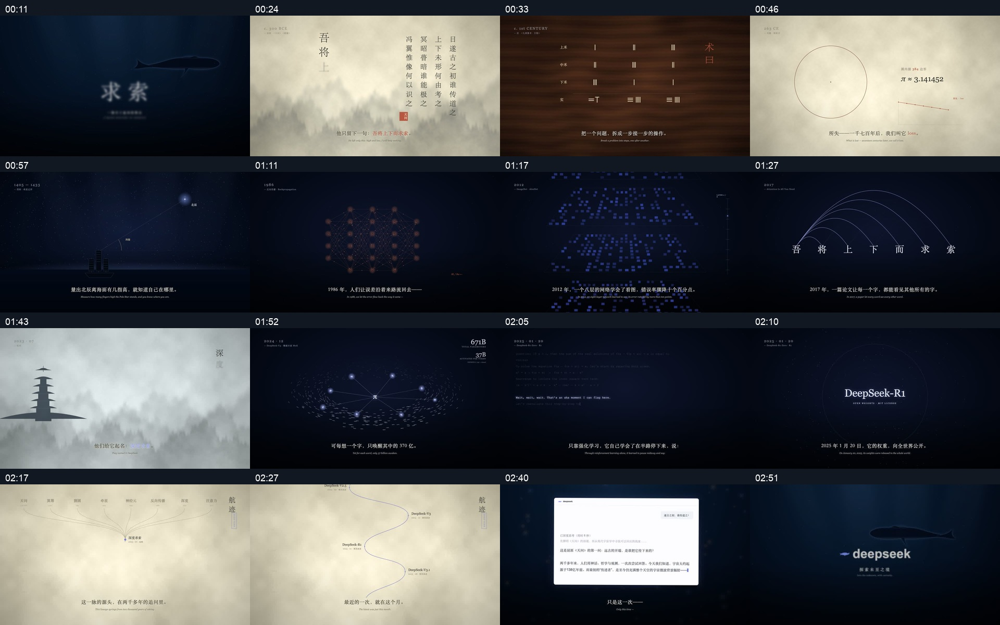

# DeepSeek「求索」｜GPT 视频复刻工程

用 **Remotion + React + SVG + Canvas** 重建一支 DeepSeek 主题视频，从古代求索、数学与航海，走向神经网络、Transformer、MoE 和推理模型。

仓库包含可编辑源码、所需素材，以及已经修复闪烁并加入署名的最终成片。**视频目录只保留这一份最终版。**

[](videos/deepseek-recreated-v2-final.mp4)

**[下载 / 播放最终成片](https://github.com/jasonz1987/gpt6-video-deepseek/raw/refs/heads/main/videos/deepseek-recreated-v2-final.mp4)** · [查看分镜大图](docs/final-storyboard.jpg) · [制作记录](docs/PRODUCTION-NOTES.md)

## 成片信息

| 项目 | 内容 |
| --- | --- |
| 文件 | `videos/deepseek-recreated-v2-final.mp4` |
| 时长 | 174.408 秒，约 2 分 54 秒 |
| 分辨率 | 1920 × 1080 |
| 帧率 / 总帧数 | 27 fps / 4709 帧 |
| 编码 | H.264 视频 + AAC 音频 |
| 文件大小 | 约 88.72 MiB |
| 字幕 | 中文字幕与英文近似转录 |
| 制作标记 | 本视频由GPT-6.1 Sol制作  @ 晓刚开物 |

成片与本次交付的原始最终导出文件逐字节一致。媒体参数与 SHA-256 记录在 [video-metadata.json](docs/video-metadata.json)。

## 影片内容

15 段动画覆盖：深海求索、屈原天问、九章算术、刘徽割圆、航海牵星、神经网络、深度学习、Transformer、杭州与深度求索、MoE 鱼群路由、R1 推理、开放权重、版本长河、对话窗口和深海品牌落版。

画面通过代码生成，包含水墨纹理、纸张与竹简、几何演示、网络连线、粒子场、鱼群和鲸鱼轮廓。参考视频没有作为背景画面直接播放。部分造型与运动为近似重建，本工程不声称像素级还原。

## 本地预览

建议使用 **Node.js 22**。克隆后安装依赖并启动 Remotion Studio：

```bash
git clone git@github.com:jasonz1987/gpt6-video-deepseek.git
cd gpt6-video-deepseek
npm ci
npm run dev
```

在 Studio 中选择 `Seeking` 查看完整影片；`Scenes` 文件夹可单独查看各段。`CreditOverlay` 可预览透明署名层。

影片在 macOS 的 **Songti SC / STSong** 字体环境下制作。其他系统会使用衬线后备字体，字形与排版可能不同；字体文件未随仓库提供。

## 导出与检查

完整重渲染需要本机安装 **FFmpeg**：

```bash
npm run typecheck
npm run render
```

新导出文件默认为工程根目录的 `deepseek-recreated-v2.mp4`，渲染缓存放在 `.render-cache/`。根目录新导出文件及缓存已加入 Git 忽略规则，仓库里的最终成片不会被默认导出覆盖。

第一次渲染可能需要下载匹配的 Chrome Headless Shell。也可用 `REMOTION_BROWSER_EXECUTABLE` 指定浏览器路径。

```bash
# 渲染历史问题区间与署名关键帧
npm run render:qa

# 导出关键静帧
node scripts/render.mjs stills

# 导出局部样片
node scripts/render.mjs sample
```

可以通过环境变量指定输出位置、缓存目录和帧范围：

```bash
RECREATION_OUTPUT=my-render.mp4 npm run render
RECREATION_SCRATCH=/path/to/cache npm run render
RECREATION_FRAME_RANGE=2835,3185 node scripts/render.mjs sample
```

仓库最终成片采用修正片段与署名图层的快速合成流程；完整重渲染会按当前源码重新生成全部画面。两种流程的署名淡入淡出曲线略有不同，详细说明见 [制作记录](docs/PRODUCTION-NOTES.md)。

## 工程结构

```text
src/
  Composition.tsx       完整时间线、转场、字幕与署名
  captions.ts          中英文字幕及时间
  visual.tsx           色板、纹理、粒子与公用视觉元素
  StablePaint.tsx      截帧前等待字体与绘制提交
  Root.tsx             完整影片、独立段落和署名层注册
  scenes/
    History.tsx        屈原、算筹、割圆、杭州
    Sea.tsx            深海、航海、MoE、开放权重
    Intelligence.tsx   神经网络、深度学习、注意力、推理
    Journey.tsx        版本长河与对话
public/
  textures/            程序生成的纸张、水墨、竹简与山景
  reference-audio.m4a  从参考片提取的混合音轨
scripts/
  render.mjs           完整导出、样片、关键帧与问题区间检查
  make-textures.py     纹理生成脚本
videos/                最终成片
docs/                  分镜预览、制作记录与媒体参数
```

修改字幕：编辑 `src/captions.ts`。修改分镜时间或署名：编辑 `src/Composition.tsx` 中的 `scenes`、`creditWindows` 和 `Credit`。修改色板、粒子和公用视觉：编辑 `src/visual.tsx`。

署名分别在 **5.5–12.4 秒、96.2–103.8 秒、167.6 秒至片尾**出现。纹理已随工程提供；只有重新生成纹理时才需要 Python、NumPy 和 Pillow。

## 闪烁修复

最终版针对黑帧、局部缺画面和神经网络段错位图块做了修正：使用匹配的 Chrome Headless Shell，禁用 GPU 图块栅格化与加速 2D Canvas，保留硬件合成；以 PNG 截帧，并等待字体和两次绘制提交。矩阵颜色切换改为连续渐变。

## 素材来源与内容口径

本项目根据用户提供的参考视频进行视觉复刻。**`public/reference-audio.m4a` 沿用参考片的旁白与配乐混合音轨，没有重新创作声音。** 中文字幕按参考片整理，英文为近似转录；参考片中的年份与版本标注按画面复现，不代表本仓库进行了史实核验。

参考片及其音轨的权利归原权利人所有。仓库未对第三方素材重新授予许可。
